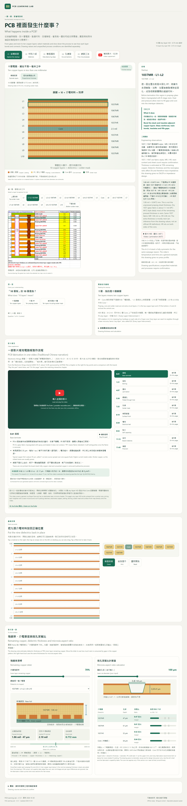

# PCB 裡面發生什麼事？10 層 Any-layer HDI 互動教學

用一張 10L any-layer HDI 疊構圖，一層一層看懂 PCB 的結構、PP／Core 材料、四次 build-up 製程與孔連接。介面與解說採繁體中文／英文並列。

- **線上版**：https://pcb-hdi-stackup.vercel.app/
- **版本**：v1.3（2026-10-07）
- **離線使用**：用 Edge 或 Chrome 直接開啟 `index.html`。不需要安裝套件、登入帳號或付費 API，原始疊構圖已內嵌在網頁裡。



## 教學章節

| 章節 | 內容 | 互動 |
|---|---|---|
| 01 結構探索 | 10 個銅層、8 個 PP 介電層、中央 Core、兩面防焊 | 點選任一層看厚度與用途；展開剖面；切換「薄層放大」或「依 mil 比例」；原圖同步以綠框標出對應列，也能直接點原圖選層 |
| 02 材料介紹 | PP 成分、壓合填隙、固化結合、Core 與 PP 對照 | 四個畫面逐步播放；壓合時有壓板與樹脂流動箭頭，固化後壓板移開 |
| 03 製程播放 | 中央 Core → 四次對稱積層（每次 8 步）→ 後段加工，共 38 步 | 播放／暫停／逐步／拖曳時間軸；跳到任一次積層；計數器顯示銅層數、壓合次數、已填孔微孔層與熱歷程；滑鼠移到時間軸上可預覽步驟名稱 |
| 04 孔連接 | 微盲孔、堆疊微孔、錯位微孔、全厚度通孔 | 藍色虛線顯示導通路徑；「自選路徑」可任選起訖層，顯示要幾段相鄰層連接、是否經過中央孔 |

右側解說欄同時提供兩種深度：先用白話說明，再接「工程觀察」，內容包括圖面數據、待確認事項，製程步驟另附「廠內常聽到」的用語（棕化、化學沉銅、電鍍填孔、LDI 等）。

## 練習與計算工具

- **想一想**：每章 4 題，答完標出對錯並計分，可重做。
- **疊構拼圖**：把 9 張介電材料（1037MR、1067MR、1037HR、Core）放回 L1–L10 之間。可點選或拖曳，附檢查答案、三段提示與重新開始。
- **殘銅率滑桿**：拖動內層殘銅率（10–100%），看介電厚度與全板總厚如何變化，並對照 0.75 ± 0.076 mm 公差。70% 時與圖面總厚 0.772 mm 一致。
- **微孔深寬比計算器**：輸入雷射孔徑，以滑桿算出的介電厚度計算各層深寬比，對照 0.8:1 建議值與 IPC-2226 的 1:1 上限。

兩個計算器都是簡化模型，只用來說明趨勢，不是正式製程資料。

## 檔案結構

| 檔案 | 用途 |
|---|---|
| `index.html` | 教學頁本體，單一檔案，原圖以 base64 內嵌 |
| `review.md` | 修訂教學稿：疊構與厚度、材料、孔結構、製程、板廠用語對照、待確認事項、參考來源 |
| `chat.md` | 原始 Gemini 對話，保留供追溯，不覆寫 |
| `assets/img-001.png` | 原始疊構圖 |
| `tools/verify.cjs` | 互動驗證腳本（Edge + Playwright），結果寫入 `verification.json`，並產生 `preview-*.png` 截圖 |
| `tools/preview.cjs` | 選用的本機預覽服務，只對 127.0.0.1 提供 |
| `tools/embed-source.cjs` | 把原圖內嵌進 `index.html` |
| `.vercelignore` | 部署時排除 `chat.md`、`tools/`、驗證結果與截圖 |

## 本機驗證

```bash
node tools/verify.cjs
```

腳本使用本機已安裝的 Edge 與 Codex 隨附的 Playwright（路徑寫在腳本開頭），目前共 14 組檢查，涵蓋：
- 38 個製程步驟的銅層數與英文解說
- 4 種材料畫面的圖形差異
- 孔型、自選路徑、原圖對照、製程計數器
- 測驗、拼圖、兩個計算器
- 320–1440px 排版不溢出、減少動態效果、`file://` 離線執行

## 部署

GitHub repo 連結 Vercel 專案 `pcb-hdi-stackup`，推送到 `main` 會自動部署到 production。沒有建置步驟，Vercel 直接提供靜態檔案。

## 內容範圍與限制

- 層別、厚度、材料註記與 Notes 依原始疊構圖。製程動畫是一般原理示意，不是製造作業指導書。
- 圖面沒有提供孔徑、線路、中央孔工法、壓合曲線與驗收規格。頁面上把這些標為「待確認」，不自行假設數值。
- 全厚度孔示例只接 L1／L10，其他層避空；上下兩半的堆疊微孔不假定穿過中央 Core。
- 外部資料（EMC EM-370(Z)-15 資料表、IPC-4412 布種、IPC-2226 深寬比）只作為參考，不代表本板實際供料或驗收標準。完整來源見 `review.md` 第 8 節與頁面底部。

## 版本紀錄

- **v1.3**：原圖對照、自選路徑、製程計數器與時間軸預覽、每章 4 題測驗、疊構拼圖；合併「入門導覽／工程詳解」為單一解說，每步 7 秒。
- **v1.2**：殘銅率滑桿、深寬比計算器、錯位微孔、廠內用語；補充銅層標示、布厚、MR／HR 觀察、Dk、高 Tg、4+2+4／ELIC；修正表面處理色塊與簡體字。
- **v1.1**：中英雙語、四個材料畫面。
