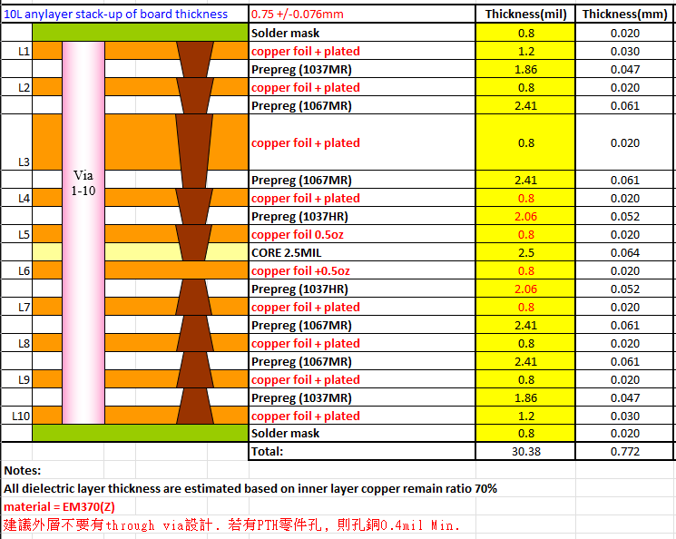

# 10\-layer PCB板材與膠片規格製程解析

**Date**: October 7, 2026 at 11:19 AM
**Turns**: 3
**Source**: [Gemini Chat](https://gemini.google.com/app/5ccfd07870bfa69a?hl=zh-TW)

---

## Turn 1

### 👤 使用者

*[This turn includes uploaded images]*

說明PCB板材與膠片規格製程

### 🤖 助理

這份疊構圖為 **10層任意層高密度互連板（10L Any-layer HDI）**，整體成品設計厚度為 **0.75 ± 0.076 mm**（疊構計算厚度約 0.772 mm / 30.38 mil）。
以下針對板材特性、膠片規格與製程工藝進行深度解析：

### 一、 核心板材規格（Core Laminate）

- **材料型號**：台光電子（EMC）**EM-370(Z)**。
- **材料等級與物性**：
  - 屬高耐熱無鹵素（Halogen-free）材料，具備極佳的抗 CAF（導電陽極絲）性能。
  - **Tg（玻璃轉移溫度）**：約 180°C（TMA）/ 210°C（DMA）。
  - **熱膨脹係數（CTE）**：Z 軸熱膨脹係數極低（50～260°C 區間約 1.8%），對 Any-layer 堆疊微盲孔（Stacked Microvias）在多次壓合與迴焊下的抗熱應力非常有利。
- **基板結構**：
  - 中心層（L5-L6）採用厚度為 **2.5 mil（0.064 mm）** 的薄 Core。
  - 原始銅厚為 **0.5 oz**，經通孔填孔或盲孔電鍍加厚後為 **0.8 mil（約 0.020 mm）**。

### 二、 膠片（Prepreg / PP）規格與厚度分析
圖中介電層厚度是依據內層殘銅率 70%（copper remain ratio 70%）估算壓合後的實際厚度：

1. **1037MR / 1037HR 膠片**：
  - **規格含義**：1037 屬於極薄型玻纖布規格（開纖布結構，常規未壓厚度約 1.1～1.3 mil 左右）。代碼 **MR** 與 **HR** 代表膠含量等級（Medium Resin / High Resin）。
  - **位置與壓合厚度**：
    - **外層（L1-L2, L9-L10）**：採用 **1037MR**，壓合估算厚度為 **1.86 mil（0.047 mm）**。
    - **內層近 Core 處（L4-L5, L6-L7）**：採用含膠量更高的 **1037HR**，壓合估算厚度為 **2.06 mil（0.052 mm）**，目的在於提供更充分的流膠量以填平 L5/L6 內層線路空隙。
2. **1067MR 膠片**：
  - **規格含義**：1067 玻纖布相較於 1037 略厚，具備較佳的尺寸穩定度與剛性，MR 代表中等膠含量。
  - **位置與壓合厚度**：
    - 分佈於 **L2-L3、L3-L4、L7-L8、L8-L9**。
    - 壓合估算厚度均為 **2.41 mil（0.061 mm）**。

### 三、 孔結構與階梯製程架構

1. **Any-layer 任意層互連（Stacked Microvia）**：
  - 圖中 L1 貫穿至 L10 為連續的堆疊微盲孔（Stacked Vias）結構（雷射鑽孔 + 電鍍填孔 Copper Fill）。
  - 製程採用逐層壓合（Sequential Build-up, SBU）工藝：
    - 先完成中心 Core（L5-L6）線路與孔導通。
    - 依序向外對稱壓合（L4/L7 → L3/L8 → L2/L9 → L1/L10），每增加一層均需歷經「壓合 → 雷射鑽孔 → 盲孔電鍍填平 → 線路蝕刻」循環。
2. **全貫通孔（Via 1-10）**：
  - 結構左側標註有貫穿 L1 至 L10 的機械鑽孔通孔。
  - 鍍銅厚度規範：
    - 表層銅厚（L1/L10）為 **1.2 mil（0.030 mm）**，內層銅厚均為 **0.8 mil（0.020 mm）**。
    - 綠漆（Solder mask）單面厚度為 **0.8 mil（0.020 mm）**。

### 四、 關鍵製程限制與工程注意事項（Notes 說明）

1. **外層避免 Through Via 設計**：
  - Any-layer 經過多達 4～5 次壓合熱循環，若在最外層同時保留機械通孔，機械鑽孔時的高深寬比電鍍容易導致外層銅皮過厚，進而破壞細線路蝕刻精度；此外，多次壓合會使板厚收縮不均，影響盲孔與通孔重疊處的結構可靠性。
2. **PTH 零件孔銅厚限制（孔銅 0.4 mil Min. / 約 10 µm）**：
  - 通常標準 PTH 要求孔銅 0.8～1.0 mil，但 Any-layer 為了維持表層線路（細線寬/線距 L/S）的精密度，必須嚴格控制外層表面加鍍銅厚。
  - 若強行鍍至 1.0 mil 孔銅，外層銅箔將大幅增厚，導致外層細線路嚴重側蝕甚至短路。因此該疊構特別註明「若有 PTH 零件孔，則孔銅僅能做到 0.4 mil Min.」，此數值屬於外層細線路與零件孔導通性能之間的折衷製程極限。

## Turn 2

### 👤 使用者

說明本疊構製程的具體運作

### 🤖 助理

本疊構為 **10層任意層（10L Any-layer / ELIC, Every Layer Interconnect）HDI板**。其核心特色在於從 L1 到 L10 每一層之間皆有微盲孔，且微盲孔可以直接縱向堆疊（Stacked Microvias）。
Any-layer HDI 的具體運作流程以「中心內核製作」為起點，採用「對稱逐層壓合（Sequential Build-up, SBU）」循環向外生長。

### 一、 總體製造工藝路徑概述
本疊構以中心 **Core 2.5 mil（L5-L6）** 為基底，整體需經歷 **4 次壓合熱循環（4 Lamination Cycles）**：

- **第 1 次壓合**：基板廠製作 L5-L6 Core。
- **第 2 次壓合**：壓合 L4 與 L7（加入 1037HR 膠片與銅箔）。
- **第 3 次壓合**：壓合 L3 與 L8（加入 1067MR 膠片與銅箔）。
- **第 4 次壓合**：壓合 L2 與 L9（加入 1067MR 膠片與銅箔）。
- **第 5 次壓合（外層）**：壓合 L1 與 L10（加入 1037MR 膠片與外層銅箔）。

### 二、 具體製程運作步驟（Step-by-Step）

#### 步驟 1：中心內核（Inner Core L5-L6）製作

1. **開料裁切**：取用厚度 2.5 mil、雙面各 0.5 oz 銅箔之 EM-370(Z) Core 基板。
2. **雷射鑽孔（Laser Drilling）/ 機械鑽孔**：形成 L5-L6 之連接孔。
3. **電鍍填孔（Copper Fill Plating）**：進行去膠渣（Desmear）與化學銅沉積，再以硫酸銅填孔電鍍將 L5-L6 孔穴完全填平，使孔口平整（Dimple 控制在極小範圍），以利後續垂直堆疊盲孔。
4. **內層線路成型**：
  - 貼乾膜、曝光（採用 LDI 數位雷射直接成像）、顯影。
  - 酸性蝕刻出 L5、L6 的電氣線路與微盲孔承接墊（Capture Pad）。
  - 剝膜後進行 **AOI（自動光學檢查）** 確認無斷短路。
5. **表面粗化（Brown Oxide / Chemical Micro-etch）**：對 L5、L6 銅面進行棕化微蝕處理，增加後續壓合結合力。

#### 步驟 2：第 1 次逐層積層（Build-up 1：形成 L4 與 L7）

1. **排板與壓合（Lamination Cycle 1）**：
  - 上下對稱排入 **1037HR 膠片**（因樹脂含量高，易於填滿 L5/L6 線路間隙）及外側銅箔。
  - 進入真空熱壓機，按照 EM-370(Z) 高溫曲線（約 190～210°C）進行壓合固化。
2. **雷射鑽孔（CO₂ / UV Laser）**：
  - 分別對 L4 往 L5、L7 往 L6 進行盲孔鑽孔。
  - 雷射精準停止在 L5、L6 的銅墊表面（Stop on copper pad）。
3. **電漿/化學除膠渣（Desmear）**：清除孔底樹脂殘渣。
4. **盲孔電鍍填銅（Via Fill）與表面減薄**：
  - 硫酸銅填孔電鍍，將 L4-L5 與 L7-L6 盲孔填平。
  - 表面需控制面銅厚度（銅箔 + 鍍銅後厚度控制在約 0.8 mil），避免內層面銅過厚影響阻抗與後續蝕刻。
5. **L4 / L7 線路製作與 AOI 檢驗**：以 LDI 曝光、蝕刻形成線路，完成 AOI 後棕化。

#### 步驟 3：第 2 次逐層積層（Build-up 2：形成 L3 與 L8）

1. **排板壓合（Lamination Cycle 2）**：對稱疊加 **1067MR 膠片** 與銅箔並壓合。
2. **雷射鑽孔**：鑽出 L3-L4 與 L8-L7 盲孔，精準對準下方已填平的 L4-L5/L7-L6 頂部銅面，形成堆疊孔（Stacked Via）結構。
3. **填孔電鍍、線路成型、AOI**：填平孔洞、蝕刻線路。

#### 步驟 4：第 3 次逐層積層（Build-up 3：形成 L2 與 L9）

1. **排板壓合（Lamination Cycle 3）**：對稱疊加 **1067MR 膠片** 與銅箔並壓合。
2. **雷射鑽孔、填孔電鍍、線路成型**：完成 L2-L3 及 L9-L8 盲孔填平與電氣互連。

#### 步驟 5：第 4 次逐層積層（Build-up 4：外層 L1 與 L10 壓合與成型）

1. **外層壓合（Lamination Cycle 4）**：
  - 疊加 **1037MR 膠片** 與外層銅箔。
  - 進行最後一次壓合，板厚總厚度達到約 0.75 mm。
2. **盲孔雷射鑽孔**：鑽出 L1-L2 及 L10-L9 雷射盲孔。
3. **機械通孔鑽孔（Via 1-10，若圖面有要求）**：
  - 若有貫穿 L1-L10 的機械通孔，在此階段以 CNC 機械鑽機進行鑽孔。
4. **外層電鍍（Outer Layer Plating）**：
  - 沉銅並加鍍，填平 L1-L2、L10-L9 雷射孔，並為 Via 1-10 孔壁鍍銅。
  - **製程矛盾控制**：外層銅厚目標為 1.2 mil（0.030 mm）。若有貫穿零件孔（PTH），為了避免外層銅過厚導致表層細線路蝕刻困難，圖面規範限制**零件孔孔銅僅能做到 0.4 mil Min.（約 10 µm）**。
5. **外層負片/正片線路製作與蝕刻**：透過精密 LDI 與真空差分蝕刻，完成高密度的 BGA 焊盤與微細線路。

#### 步驟 6：後段製程與檢驗

1. **防焊綠漆（Solder Mask）**：塗布、曝光顯影，單面厚度約 0.8 mil（0.020 mm）。
2. **表面處理（Surface Finish）**：如化鎳浸金（ENIG）或化學鎳鈀金（ENEPIG），確保打線與微間距 BGA 銲接平整度。
3. **成型與測試**：
  - CNC 銑外型。
  - **四線式高壓開短路電性測試（E-Test / Flying Probe）**，確保 10 層堆疊盲孔微導通電阻完全正常。
  - 切片分析（Cross-section Microsection），檢驗微盲孔堆疊處有無裂紋（Void/Separation）及孔銅厚度。

### 三、 此運作架構下的核心工程控制重點

1. **熱收縮與漲縮補償（Layer Registration Control）**：
  - 板材 EM-370(Z) 經歷多達 4 次 200°C 左右的壓合循環，基材在 X-Y 軸會持續收縮。
  - 每一層曝光（LDI）均需依據前一層實測的靶標位置進行非線性動態光學補償，避免堆疊孔（Stacked Via）上下錯位而造成斷路。
2. **雷射孔填平凹陷（Dimple Depth）**：
  - 堆疊盲孔要求每層電鍍填孔後的凹陷深度（Dimple）小於 5 µm。若內層凹陷過大，堆疊至 4～5 層時，頂層會產生累積性空洞，引發熱應力斷裂。

## Turn 3

### 👤 使用者

PP膠片中玻纖布材料也是隸屬於台光電子（EMC）EM-370(Z),對嗎?

### 🤖 助理

**結論先行：** **是的，整張疊構中的 Prepreg（PP膠片）完全隸屬於台光電子（EMC）的 EM-370(Z) 體系。** 但需要精確區分「**樹脂膠系體系**」與「**原始玻纖布織造來源**」的工程定義：

### 1. 產品型號與供貨體系：EMC EM-37B(Z)
在 CCL（銅箔基板廠）的命名規則中，同一個材料體系會區分基板與膠片：

- **EM-370(Z)**：代表台光電子的**基板（Laminate / Core）**，即圖中的 `CORE 2.5MIL`。
- **EM-37B(Z)**：代表台光電子配套的**半固化膠片（Prepreg / PP）**。 圖面上 Notes 標註的 `material = EM370(Z)` 屬於業界統一表示法，意指該 PCB 專案**全板採用 EMC EM-370(Z) / EM-37B(Z) 材料體系**，所有 PP（1037MR、1037HR、1067MR）皆由台光電子原廠含浸塗布出貨，以確保熱膨脹係數（CTE）、Tg 點及固化反應速率的一致性。

### 2. 「玻纖布」與「樹脂膠水」的組成解析
一張 PP 膠片由「**玻纖布（Glass Fabric）**」浸漬「**樹脂配方（Resin Matrix）**」烘烤至 B-Stage 而成：

- **樹脂部分（決定型號特性）**：
  - 由台光電子調配的無鹵素、高耐熱環氧樹脂配方（即 370(Z) 體系），賦予材料超低 Z 軸熱膨脹（CTE 1.8%）與高耐熱性。
  - 代碼 **MR（Medium Resin）** 與 **HR（High Resin）** 是台光針對此樹脂量定義的含膠率等級（如 1037MR 與 1037HR）。
- **玻纖布部分（業界標準編號）**：
  - **1037** 與 **1067** 是國際 IPC 標準的**電子級無鹼玻璃纖維布（E-Glass）編號**，代表纖維粗細、織法密度與開纖結構（Spread Glass）。
  - 玻纖布本身通常來自台玻（TGI）、宏和、日東紡（Nittobo）等專業紡織布廠，台光電子採購標準規格玻纖布後，於自廠含浸 EM-370(Z) 樹脂製成半固化片（PP）。

### 總結
該板疊構中的 PP 膠片（1037MR、1037HR、1067MR）即為**台光電子出品的 EM-370(Z) 配套膠片（規格代號 EM-37B(Z)）**；高可靠度 Any-layer HDI 製程必須維持全板採用同廠牌同系列樹脂，嚴禁混用不同廠牌膠片，否則會在多次壓合時因收縮率不均導致爆板或孔拉裂。

---

*Exported from [Voyager](https://github.com/Nagi-ovo/voyager)*  
*Generated on October 7, 2026 at 11:19 AM*